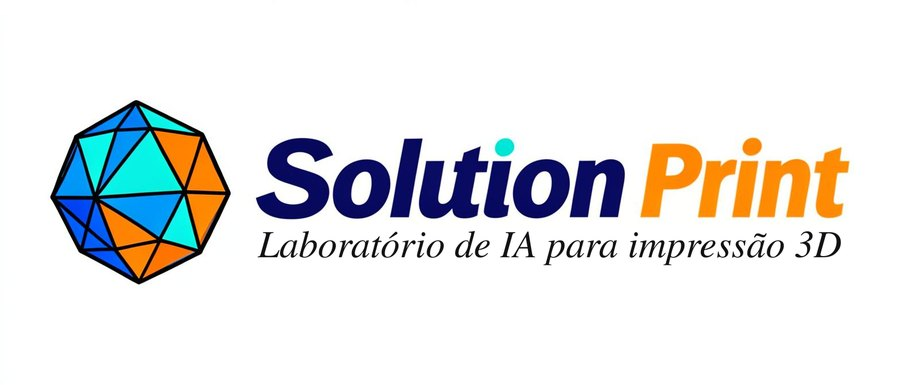

<div align="center">



</div>

# Solution Print AI Lab — camada de laboratório

Este repositório é o **Solution-hub-lab**: laboratório de modelos pequenos e
gratuitos da Solution Print. Ele contém duas coisas bem separadas:

| Parte | Onde | Situação |
|---|---|---|
| **Upstream MiniMind** (Jingyao Gong, Apache-2.0) | `model/`, `trainer/`, `dataset/`, `scripts/`, `images/`, `README.md` | importado por GitHub Actions, **não modificado** |
| **Camada Solution Print** | `solution_print/`, `tests/`, `docs/`, `evidence/` | própria, testada, independente do upstream |

O README original do MiniMind continua em [README.md](./README.md) (e
[README_en.md](./README_en.md)). Autoria, licença e histórico do upstream são
preservados — ver [SOLUTION_PRINT_ORIGIN.md](./SOLUTION_PRINT_ORIGIN.md).

## O que a camada faz hoje (verificado)

```text
$ python3 -m unittest discover -s tests -t .
Ran 143 tests in 9.2s
OK

$ python3 -m solution_print doctor
perfil cpu-low · RAM 3,82 GB · 2 núcleos · sem GPU · 7 adaptadores (1 habilitado)

$ python3 -m solution_print route --task ptbr
Cadeia autorizada: sp-echo-baseline-v1
```

- **Registro de modelos** com licença, parâmetros, capacidades, requisitos de
  hardware e limitações (`solution_print/catalog.json`).
- **Roteador** que escolhe por tarefa, custo **sempre free**, hardware
  disponível e fallback apenas entre modelos explicitamente autorizados.
- **Adaptadores**: fixture determinística, HTTP compatível com OpenAI e
  MiniMind (torch carregado só quando há checkpoint).
- **Avaliação PT-BR** com 7 tipos de checagem e comparação entre modelos.
- **Segurança**: validação de entrada, redação de segredos, gateway de
  ferramentas em que o modelo só **propõe** — nunca executa.
- **API HTTP local** (`/health`, `/v1/models`, `/v1/chat/completions`,
  `/v1/lab/route`) com Bearer token fora do loopback.
- **Experimentos** com hash de configuração, ambiente, versão de código e
  histórico em JSONL.

## Comandos

```bash
python3 -m solution_print doctor            # hardware + adaptadores
python3 -m solution_print models list       # catálogo
python3 -m solution_print models validate   # valida o catálogo
python3 -m solution_print route --task ptbr # decisão de roteamento
python3 -m solution_print infer --prompt "..." --json
python3 -m solution_print eval --out /tmp/eval
python3 -m solution_print serve --port 8765 # API local
python3 -m unittest discover -s tests -t .   # 143 testes
```

Sem `pip install`: só biblioteca padrão do Python 3.11+. PyTorch só é
necessário para o adaptador MiniMind real.

## Honestidade sobre os resultados

- A inferência padrão vem do adaptador de **fixture** e é marcada
  `simulated: true` na resposta. Ela valida o caminho completo, **não** a
  qualidade de um LLM.
- O MiniMind real ainda não rodou aqui: faltam `torch`, `transformers` e
  checkpoint. Registro em [evidence/08_bloqueios.txt](./evidence/08_bloqueios.txt).
- Custo da operação até agora: **R$ 0,00** (nenhum serviço pago, nenhuma GPU).

## Documentos

| Documento | Conteúdo |
|---|---|
| [docs/MASTER_EXECUTION_MATRIX.md](./docs/MASTER_EXECUTION_MATRIX.md) | lotes, critérios, estado e evidência |
| [docs/TEST_EVIDENCE_MATRIX.md](./docs/TEST_EVIDENCE_MATRIX.md) | 143 testes, arquivo por arquivo |
| [docs/INTEGRATION_STATUS.md](./docs/INTEGRATION_STATUS.md) | AI CORE, JARVIS, CRM, Android, Studio 3D |
| [docs/SECURITY_REVIEW.md](./docs/SECURITY_REVIEW.md) | controles e falhas corrigidas |
| [docs/HARDWARE_COMPATIBILITY.md](./docs/HARDWARE_COMPATIBILITY.md) | perfis e limites reais |
| [docs/FINAL_ACCEPTANCE_REPORT.md](./docs/FINAL_ACCEPTANCE_REPORT.md) | aceitação final |
| [evidence/](./evidence/) | logs com data, branch, comando e exit code |
